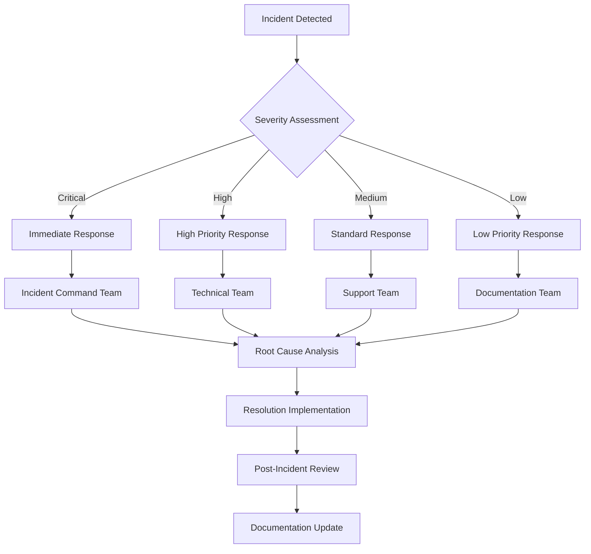
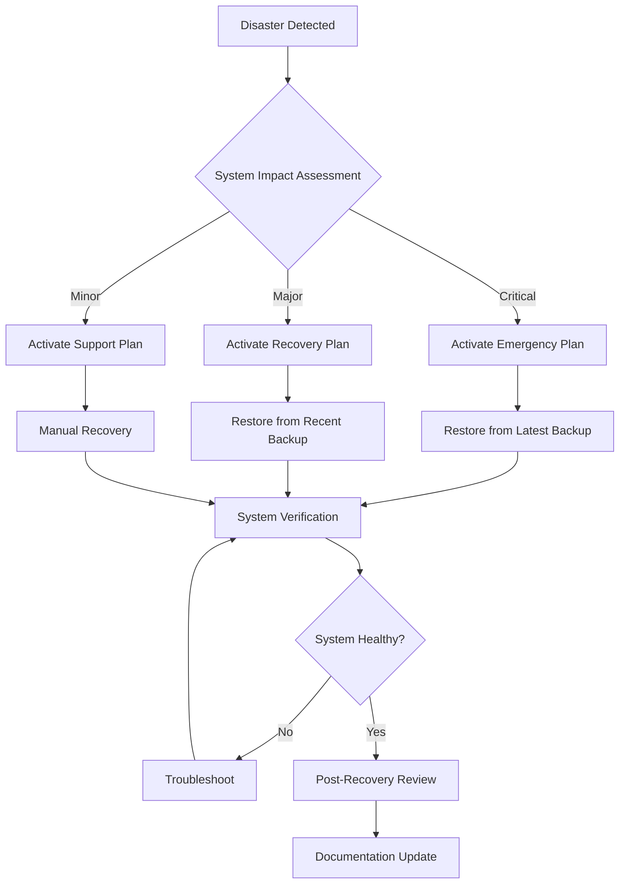

# 🔧 Fluentive CRM - Post-Launch Monitoring & Maintenance Guide

## 📋 Executive Summary

**Purpose**: Comprehensive guide for monitoring, maintaining, and optimizing Fluentive CRM after launch
**Target Audience**: DevOps Engineers, System Administrators, Support Teams
**Maintenance Window**: 24/7 monitoring with scheduled maintenance windows
**SLA**: 99.9% uptime target with < 5-minute response time for critical issues

---

## 🚀 24/7 Monitoring Dashboard

### **📊 Core System Metrics**

#### **Health Status Indicators**
- **Overall System Health**: Green/Yellow/Red status
- **API Response Time**: Average response time < 5 seconds
- **Database Performance**: Query time < 500ms
- **Memory Usage**: < 80% of allocated memory
- **CPU Utilization**: < 70% average usage
- **Error Rate**: < 1% of total requests
- **Uptime**: 99.9% target

#### **Business Metrics**
- **Active Users**: Current active user count
- **API Requests**: Requests per minute
- **Database Connections**: Active connections
- **File Storage**: Storage usage percentage
- **AI Model Performance**: Model accuracy and response time
- **Backup Status**: Last backup success/failure

### **🔍 Monitoring Tools Setup**

#### **Vercel Analytics Integration**
```javascript
// Vercel Analytics Configuration
const analytics = {
  enabled: true,
  trackPageViews: true,
  trackEvents: true,
  trackWebVitals: true,
  trackAPI: true
};
```

#### **Custom Health Endpoints**
```bash
# System Health Check
GET /api/health

# Memory Health Check
GET /api/health/memory

# Database Health Check
GET /api/health/database

# API Performance Check
GET /api/health/performance
```

#### **Third-Party Monitoring**
- **Sentry**: Error tracking and performance monitoring
- **Uptime Robot**: External uptime monitoring
- **Pingdom**: Synthetic transaction monitoring
- **DataDog**: Infrastructure monitoring (optional)

---

## 📈 Performance Monitoring

### **⚡ Frontend Performance**

#### **Core Web Vitals**
- **LCP (Largest Contentful Paint)**: < 2.5 seconds
- **FID (First Input Delay)**: < 100 milliseconds
- **CLS (Cumulative Layout Shift)**: < 0.1
- **FCP (First Contentful Paint)**: < 1.8 seconds
- **TTI (Time to Interactive)**: < 3.8 seconds

#### **Monitoring Scripts**
```javascript
// Performance Monitoring Script
const performanceObserver = new PerformanceObserver((list) => {
  const entries = list.getEntries();
  entries.forEach((entry) => {
    if (entry.entryType === 'navigation') {
      console.log('Page Load Time:', entry.loadEventEnd - entry.fetchStart);
    }
  });
});

performanceObserver.observe({ entryTypes: ['navigation'] });
```

#### **Alert Thresholds**
- **Page Load Time**: Alert if > 5 seconds
- **API Response Time**: Alert if > 10 seconds
- **JavaScript Errors**: Alert on any unhandled errors
- **Memory Leaks**: Alert on memory usage > 80%

### **🔧 Backend Performance**

#### **API Performance Metrics**
- **Response Time**: < 5 seconds average
- **Throughput**: > 100 requests/second
- **Error Rate**: < 1% of requests
- **Database Query Time**: < 500ms average
- **Memory Usage**: < 2GB (Vercel limit)

#### **Database Performance**
```sql
-- Performance Monitoring Queries
SELECT 
  query,
  calls,
  total_time,
  mean_time,
  stddev_time
FROM pg_stat_statements 
ORDER BY mean_time DESC 
LIMIT 10;
```

#### **Alert Configuration**
```yaml
# Performance Alerts
alerts:
  api_response_time:
    threshold: 5000ms
    severity: warning
  database_query_time:
    threshold: 500ms
    severity: critical
  memory_usage:
    threshold: 80%
    severity: warning
  error_rate:
    threshold: 1%
    severity: critical
```

---

## 🔒 Security Monitoring

### **🛡️ Security Dashboard**

#### **Security Metrics**
- **Failed Login Attempts**: Track failed logins
- **Suspicious Activity**: Unusual API usage patterns
- **Security Events**: Authentication, authorization events
- **Vulnerability Scans**: Regular security scans
- **Data Access Logs**: Who accessed what data when
- **2FA Usage**: Two-factor authentication adoption

#### **Security Monitoring Scripts**
```javascript
// Security Event Monitoring
const securityMonitor = {
  trackLogin: (userId, ip, userAgent, success) => {
    // Log login attempts
    if (!success) {
      // Alert on multiple failed attempts
      checkBruteForce(ip, userId);
    }
  },
  
  trackAPIAccess: (userId, endpoint, method) => {
    // Track API access patterns
    detectAnomalousAccess(userId, endpoint);
  },
  
  trackDataAccess: (userId, resource, action) => {
    // Log data access for audit trail
    createAuditLog(userId, resource, action);
  }
};
```

#### **Security Alerts**
- **Brute Force Detection**: Alert on > 5 failed attempts
- **Unusual IP**: Alert on unknown IP addresses
- **API Abuse**: Alert on unusual API usage
- **Data Breach**: Alert on suspicious data access
- **Privilege Escalation**: Alert on permission changes

---

## 📊 Business Intelligence Monitoring

### **📈 Business Metrics Dashboard**

#### **User Engagement Metrics**
- **Daily Active Users (DAU)**: Users active per day
- **Monthly Active Users (MAU)**: Users active per month
- **User Retention**: User retention rates
- **Feature Adoption**: Which features are used most
- **Session Duration**: Average session length
- **Page Views**: Page views per session

#### **CRM Performance Metrics**
- **Lead Conversion Rate**: Lead to deal conversion
- **Sales Pipeline Velocity**: Time through pipeline stages
- **Deal Win Rate**: Percentage of deals won
- **Average Deal Size**: Average deal value
- **Sales Cycle Length**: Average time to close deals

#### **AI Model Performance**
- **Lead Scoring Accuracy**: Model accuracy over time
- **Churn Prediction Accuracy**: Prediction accuracy
- **Sales Forecast Accuracy**: Forecast vs actual
- **Model Training Time**: Time to train models
- **API Response Time**: AI model response time

### **📋 Business Intelligence Queries**

#### **User Analytics**
```sql
-- User Engagement Analytics
SELECT 
  DATE_TRUNC('day', created_at) as date,
  COUNT(DISTINCT user_id) as daily_users,
  COUNT(*) as total_sessions,
  AVG(session_duration) as avg_session_duration
FROM user_sessions 
WHERE created_at >= NOW() - INTERVAL '30 days'
GROUP BY DATE_TRUNC('day', created_at)
ORDER BY date DESC;
```

#### **CRM Performance**
```sql
-- Sales Pipeline Analytics
SELECT 
  stage,
  COUNT(*) as deal_count,
  AVG(value) as avg_deal_value,
  AVG(EXTRACT(EPOCH FROM (updated_at - created_at))/86400) as avg_days_in_stage
FROM deals 
WHERE isDeleted = false
GROUP BY stage
ORDER BY stage;
```

---

## 🔧 Maintenance Procedures

### **📅 Daily Maintenance Tasks**

#### **Automated Daily Checks**
```bash
#!/bin/bash
# Daily Maintenance Script

# 1. System Health Check
curl -s https://your-domain.vercel.app/api/health | jq '.status'

# 2. Database Health Check
curl -s https://your-domain.vercel.app/api/health/database | jq '.status'

# 3. Memory Usage Check
curl -s https://your-domain.vercel.app/api/health/memory | jq '.memory.heapUsed'

# 4. Backup Verification
ls -la /backup/ | grep "$(date +%Y%m%d)"

# 5. Log Analysis
tail -100 /var/log/app.log | grep ERROR

# 6. Performance Metrics
curl -s https://your-domain.vercel.app/api/analytics/overview | jq '.data'
```

#### **Daily Reports**
- **System Health Report**: Automated health status
- **Performance Report**: Key performance metrics
- **Security Report**: Security events summary
- **Usage Report**: User activity summary
- **Error Report**: Error analysis and trends

### **📅 Weekly Maintenance Tasks**

#### **Weekly System Review**
```bash
#!/bin/bash
# Weekly Maintenance Script

# 1. Database Optimization
npx prisma db push --force-reset

# 2. Cache Clearing
curl -X POST https://your-domain.vercel.app/api/cache/clear

# 3. Log Rotation
logrotate /etc/logrotate.d/fluentive-crm

# 4. Security Audit
npx audit

# 5. Performance Analysis
curl -s https://your-domain.vercel.app/api/analytics/performance

# 6. Backup Verification
restore_test=$(curl -s -X POST https://your-domain.vercel.app/api/backup/test-restore)
echo $restore_test
```

#### **Weekly Reports**
- **Performance Analysis**: Detailed performance report
- **Security Audit**: Weekly security assessment
- **User Feedback**: User feedback analysis
- **Feature Usage**: Feature adoption metrics
- **System Updates**: Update and patch status

### **📅 Monthly Maintenance Tasks**

#### **Monthly System Updates**
```bash
#!/bin/bash
# Monthly Maintenance Script

# 1. Dependency Updates
npm update
npm audit fix

# 2. Security Patches
npm audit

# 3. Database Maintenance
npx prisma migrate deploy

# 4. Performance Optimization
npx prisma db seed

# 5. Model Retraining
curl -X POST https://your-domain.vercel.app/api/ai/retrain-models

# 6. Full System Backup
curl -X POST https://your-domain.vercel.app/api/backup/full
```

#### **Monthly Reports**
- **System Performance**: Monthly performance analysis
- **Security Assessment**: Monthly security review
- **User Analytics**: Monthly user behavior analysis
- **Business Metrics**: Monthly business performance
- **Capacity Planning**: Resource utilization and planning

---

## 🚨 Incident Management

### **📋 Incident Response Plan**

#### **Incident Classification**
- **Critical**: System down, data loss, security breach
- **High**: Major feature failure, performance degradation
- **Medium**: Minor feature issues, slow performance
- **Low**: UI issues, documentation errors

#### **Response Time SLA**
- **Critical**: 15 minutes response, 1 hour resolution
- **High**: 30 minutes response, 4 hours resolution
- **Medium**: 2 hours response, 24 hours resolution
- **Low**: 24 hours response, 72 hours resolution

#### **Incident Response Process**


### **📞 Escalation Procedures**

#### **Level 1: Support Team**
- **Response Time**: 2 hours
- **Capabilities**: Basic troubleshooting, user support
- **Escalation**: To Level 2 after 4 hours

#### **Level 2: Technical Team**
- **Response Time**: 30 minutes
- **Capabilities**: Technical troubleshooting, system administration
- **Escalation**: To Level 3 for critical issues

#### **Level 3: Engineering Team**
- **Response Time**: 15 minutes
- **Capabilities**: System architecture, code fixes, emergency patches
- **Escalation**: To Management for major incidents

---

## 📊 Monitoring Tools Configuration

### **🔧 Vercel Analytics Setup**

#### **Analytics Configuration**
```javascript
// vercel.json
{
  "analytics": {
    "enabled": true,
    "trackPageViews": true,
    "trackEvents": true,
    "trackWebVitals": true
  },
  "functions": {
    "memory": 1024,
    "maxDuration": 30
  }
}
```

#### **Custom Analytics Events**
```javascript
// Custom Analytics Events
import { Analytics } from '@vercel/analytics/react';

export function trackUserAction(action, details) {
  Analytics.track(action, {
    category: 'user_action',
    ...details
  });
}

export function trackAPIPerformance(endpoint, duration, status) {
  Analytics.track('api_performance', {
    endpoint,
    duration,
    status,
    category: 'api'
  });
}
```

### **📈 Sentry Error Tracking**

#### **Sentry Configuration**
```javascript
// sentry.config.js
import * as Sentry from '@sentry/nextjs';

Sentry.init({
  dsn: process.env.SENTRY_DSN,
  environment: process.env.NODE_ENV,
  tracesSampleRate: 0.1,
  beforeSend(event) {
    // Filter out certain errors
    if (event.exception) {
      const error = event.exception.values[0];
      if (error.type === 'ChunkLoadError') {
        return null;
      }
    }
    return event;
  }
});
```

#### **Error Monitoring**
```javascript
// Error Monitoring
export function captureError(error, context = {}) {
  Sentry.captureException(error, {
    tags: {
      component: context.component,
      action: context.action
    },
    extra: context
  });
}

export function captureMessage(message, level = 'info') {
  Sentry.captureMessage(message, level);
}
```

---

## 🔄 Backup & Recovery Procedures

### **💾 Automated Backup System**

#### **Backup Schedule**
- **Full Backups**: Daily at 2:00 AM UTC
- **Incremental Backups**: Every 4 hours
- **Database Backups**: Every 6 hours
- **File Backups**: Daily at 3:00 AM UTC
- **Configuration Backups**: Weekly

#### **Backup Verification**
```bash
#!/bin/bash
# Backup Verification Script

# 1. Check Backup Integrity
backup_integrity_check() {
  local backup_file=$1
  if [ -f "$backup_file" ]; then
    echo "Backup exists: $backup_file"
    # Verify backup integrity
    tar -tzf "$backup_file" > /dev/null 2>&1
    if [ $? -eq 0 ]; then
      echo "Backup integrity: OK"
    else
      echo "Backup integrity: FAILED"
      send_alert "Backup integrity check failed for $backup_file"
    fi
  else
    echo "Backup missing: $backup_file"
    send_alert "Backup missing: $backup_file"
  fi
}

# 2. Test Database Restore
test_database_restore() {
  local backup_file=$1
  echo "Testing database restore from $backup_file"
  
  # Create test database
  createdb fluentive_test_restore
  
  # Restore from backup
  pg_restore -d fluentive_test_restore "$backup_file"
  
  # Verify restore
  if [ $? -eq 0 ]; then
    echo "Database restore test: PASSED"
    dropdb fluentive_test_restore
  else
    echo "Database restore test: FAILED"
    send_alert "Database restore test failed"
  fi
}

# 3. Run Verification
backup_integrity_check "/backup/$(date +%Y%m%d)_full.tar.gz"
test_database_restore "/backup/$(date +%Y%m%d)_database.sql"
```

### **🔄 Disaster Recovery Procedures**

#### **Recovery Time Objective (RTO)**
- **Critical Systems**: 1 hour
- **Important Systems**: 4 hours
- **Non-Critical Systems**: 24 hours

#### **Recovery Point Objective (RPO)**
- **Critical Data**: 15 minutes
- **Important Data**: 1 hour
- **Non-Critical Data**: 24 hours

#### **Disaster Recovery Plan**


---

## 📋 Maintenance Calendar

### **📅 Monthly Maintenance Schedule**

#### **Week 1: System Updates**
- **Monday**: Dependency updates and security patches
- **Tuesday**: Database optimization and indexing
- **Wednesday**: Performance monitoring and tuning
- **Thursday**: Security audit and vulnerability scanning
- **Friday**: Backup verification and testing

#### **Week 2: Feature Updates**
- **Monday**: User feedback analysis and prioritization
- **Tuesday**: Feature development and testing
- **Wednesday**: Feature deployment and monitoring
- **Thursday**: User training and documentation
- **Friday**: Performance impact assessment

#### **Week 3: Performance Optimization**
- **Monday**: Performance metrics analysis
- **Tuesday**: Code optimization and refactoring
- **Wednesday**: Database query optimization
- **Thursday**: Caching strategy review
- **Friday**: Load testing and capacity planning

#### **Week 4: Security & Compliance**
- **Monday**: Security audit and penetration testing
- **Tuesday**: Compliance review and documentation
- **Wednesday**: User access review and cleanup
- **Thursday**: Security training and awareness
- **Friday**: Incident response drill

---

## 📞 Support Procedures

### **🎯 Support Tiers**

#### **Tier 1: Basic Support**
- **Response Time**: 24 hours
- **Capabilities**: User guidance, basic troubleshooting
- **Channels**: Email, help desk, knowledge base
- **Escalation**: To Tier 2 after 48 hours

#### **Tier 2: Technical Support**
- **Response Time**: 4 hours
- **Capabilities**: Technical troubleshooting, system administration
- **Channels**: Phone, email, remote access
- **Escalation**: To Tier 3 after 8 hours

#### **Tier 3: Engineering Support**
- **Response Time**: 1 hour
- **Capabilities**: Code fixes, system architecture, emergency patches
- **Channels**: Phone, emergency contact, on-site support
- **Escalation**: To management for critical issues

### **📚 Knowledge Base Management**

#### **Documentation Updates**
- **Daily**: New issues and solutions
- **Weekly**: Feature updates and changes
- **Monthly**: Comprehensive review and updates
- **Quarterly**: Major documentation overhaul

#### **Knowledge Base Structure**
```
Knowledge Base/
├── User Guides/
│   ├── Getting Started
│   ├── Feature Guides
│   └── Troubleshooting
├── Admin Guides/
│   ├── System Administration
│   ├── User Management
│   └── Security
├── Technical Documentation/
│   ├── API Documentation
│   ├── Database Schema
│   └── System Architecture
└── Support Procedures/
    ├── Incident Response
    ├── Maintenance Procedures
    └── Escalation Procedures
```

---

## 🎯 Success Metrics & KPIs

### **📊 Technical KPIs**
- **Uptime**: 99.9% target
- **Mean Time to Resolution (MTTR)**: < 4 hours
- **Mean Time Between Failures (MTBF)**: > 720 hours
- **System Availability**: > 99.9%
- **Performance**: < 5 second response time
- **Security**: < 1 security incident per quarter

### **📈 Business KPIs**
- **Customer Satisfaction**: > 4.5/5 rating
- **Support Resolution Rate**: > 95%
- **User Adoption**: > 80% feature adoption
- **System Utilization**: > 70% capacity utilization
- **Cost Efficiency**: < $0.10 per user per month
- **Growth Rate**: > 10% month-over-month

---

## 🚀 Future Enhancements

### **📋 Roadmap Items**

#### **Short Term (3 Months)**
- **Advanced Analytics**: Enhanced business intelligence
- **Mobile Apps**: Native iOS and Android applications
- **Advanced AI**: GPT-4 integration and advanced ML models
- **Real-time Collaboration**: Advanced real-time features

#### **Medium Term (6 Months)**
- **Microservices Architecture**: Gradual microservices migration
- **Advanced Security**: Enhanced security features
- **Global Expansion**: Additional regions and languages
- **Enterprise Features**: Advanced enterprise capabilities

#### **Long Term (12 Months)**
- **AI-Powered Automation**: Advanced workflow automation
- **Predictive Analytics**: Advanced predictive capabilities
- **Blockchain Integration**: Secure data integration
- **IoT Integration**: Internet of Things capabilities

---

## 📞 Emergency Contacts

### **🚨 Critical Incidents**
- **On-Call Engineer**: +1-555-0123
- **System Administrator**: +1-555-0124
- **Security Team**: +1-555-0125
- **Management**: +1-555-0126

### **📧 Support Channels**
- **Email Support**: support@fluentive.com
- **Phone Support**: +1-555-0100
- **Emergency**: emergency@fluentive.com
- **Documentation**: https://docs.fluentive.com

---

## 🎉 Conclusion

This comprehensive monitoring and maintenance guide ensures that your Fluentive CRM remains **healthy, secure, and performant** after launch. With proper monitoring, regular maintenance, and prompt incident response, your system will continue to deliver value to users and support business growth.

**Key Success Factors:**
- **Proactive Monitoring**: Early detection of issues
- **Regular Maintenance**: Preventive maintenance procedures
- **Rapid Response**: Quick incident resolution
- **Continuous Improvement**: Ongoing optimization
- **User Support**: Excellent user experience

---

*Post-Launch Monitoring Guide Version: 3.0.0*
*Last Updated: January 15, 2026*
*Status: ✅ Ready for Implementation*
